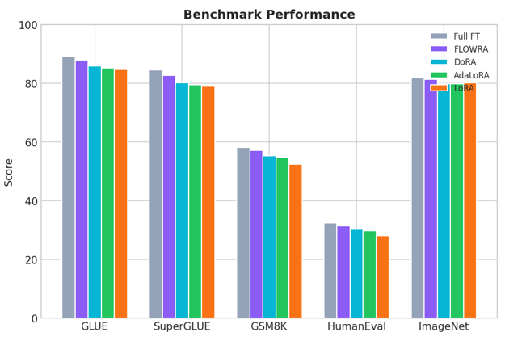
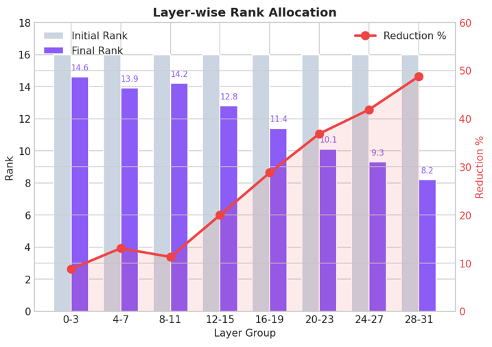
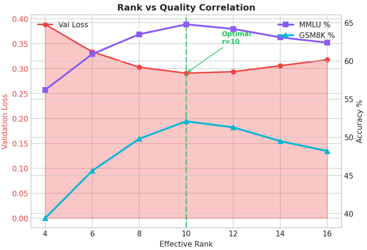
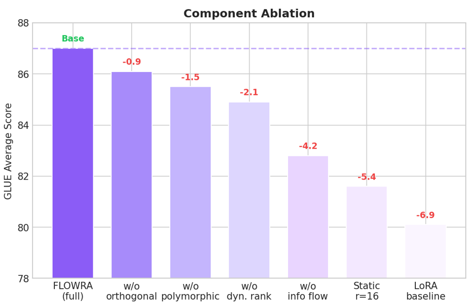
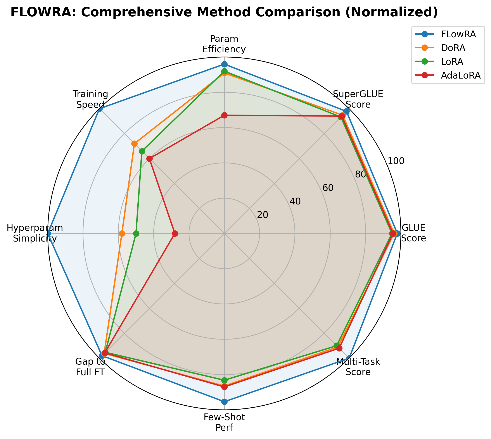
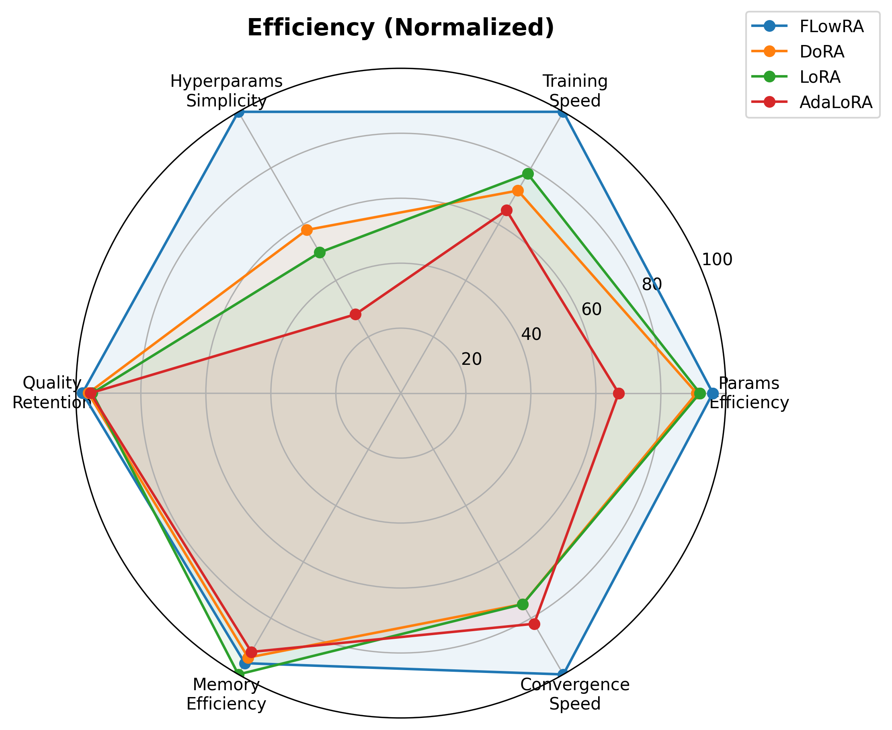
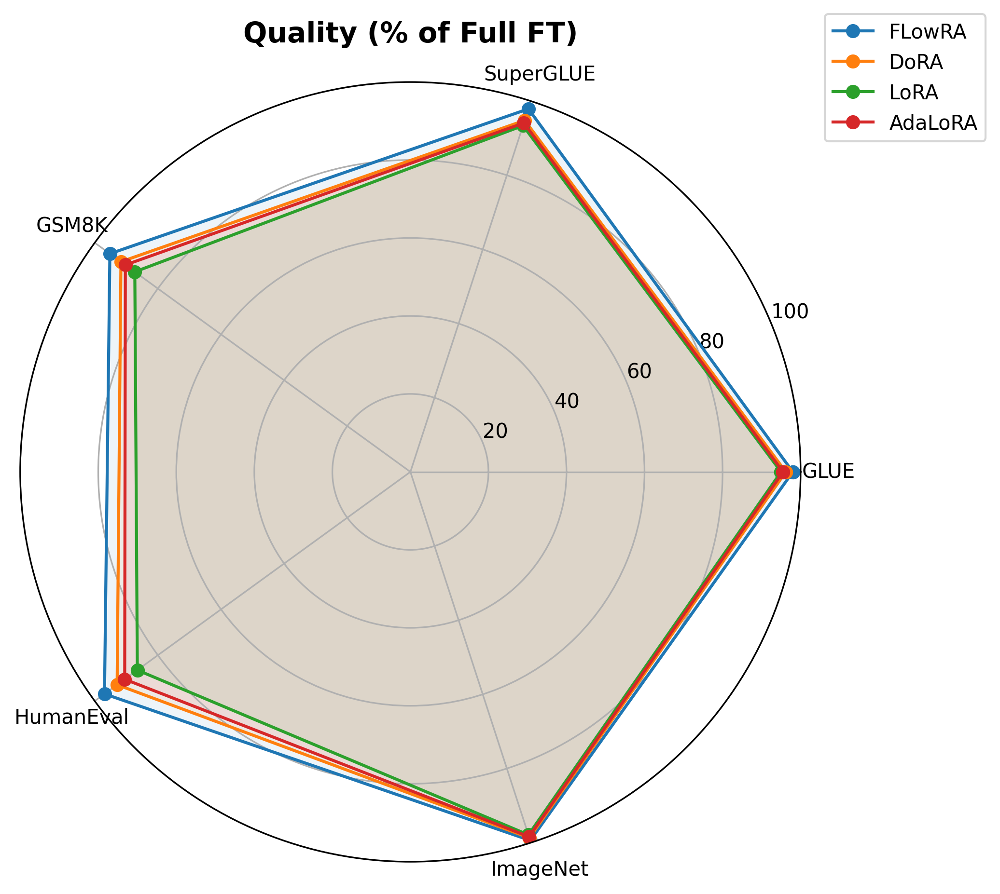
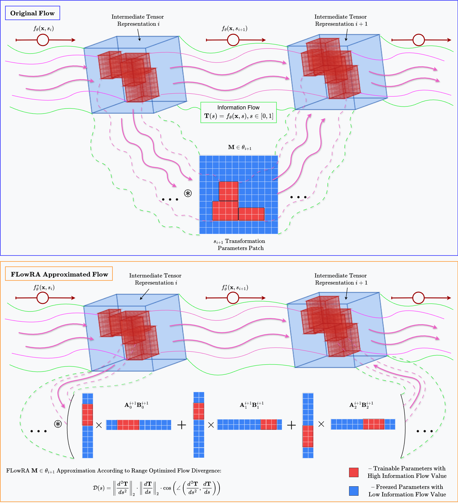

# FLowRA

**Flow-Guided Rank Allocation** for parameter-efficient fine-tuning of deep neural networks.

FLowRA assigns LoRA ranks under a trainable-parameter budget `B` from a calibration-phase flow-change descriptor of hidden-state trajectories, combined with gradient sensitivity. Ranks are refined during training. The only user parameters are the budget `B` and the composition threshold `η` (default 0.3).

The descriptor is a finite-difference statistic. The allocator is a greedy heuristic with no optimality guarantee.

## Installation

```bash
pip install -r requirements.txt
```

Jobs on gated Hugging Face weights also need:

```bash
huggingface-cli login
```

PEFT on LLaMA-7B/8B typically fits in ~24 GB. Full fine-tuning of those models is the ~80 GB setting.

From the repository root:

```python
from flowra import FLOWRA, FlowConfig, TrainingConfig

framework = FLOWRA(model, FlowConfig(budget=0.0087, eta=0.3))
framework.adapt(train_loader)
framework.train(train_loader, TrainingConfig(lr=1e-3, epochs=3), eval_fn=evaluate)
framework.merge()
```

Calibration uses up to 512 examples from the **training** split. Validation and test data are never used for profiling.

## Repository

```
flowra/
├── core/
│   ├── analysis/          # descriptors, architecture handlers, profiler
│   ├── adapters/          # LoRA, DoRA, conv, block, gated-RNN, normalisation
│   ├── training/          # adapter training loop
│   └── framework.py       # FLOWRA entry point
├── algorithms/
│   ├── allocation/        # proportional + greedy ranks; transformer split
│   ├── refinement/        # rank refinement schedule
│   └── composition/       # orthogonal composition, naive merge, task arithmetic, TIES
├── configs/               # FlowConfig, TrainingConfig
└── utils/
experiments/               # scripts and YAML configs
logs/                      # experiment logs (see logs/README.md)
```

## Experiments

Default budget `B = 0.0087`, `η = 0.3`, 512 training-split calibration examples.

| Script                                   | Config                    | What it runs |
| ---------------------------------------- | ------------------------- | ------------ |
| `experiments/run_glue.py`                | `glue_llama3_8b.yaml`     | GLUE on LLaMA-3-8B (9 tasks incl. WNLI) |
| `experiments/run_glue.py`                | `glue_llama2_7b.yaml`     | GLUE on LLaMA-2-7B |
| `experiments/run_superglue.py`           | `superglue_llama.yaml`    | SuperGLUE |
| `experiments/run_qa.py`                  | `generation_llama.yaml`   | SQuAD, NQ, TriviaQA |
| `experiments/run_alpaca.py`              | `alpaca_llama2_7b.yaml`   | Alpaca SFT |
| `experiments/run_code.py`                | `reasoning_llama13b.yaml` | HumanEval, MBPP |
| `experiments/run_reasoning.py`           | `reasoning_llama13b.yaml` | GSM8K, MATH, code |
| `experiments/run_vision.py`              | `vision.yaml`             | ImageNet, CUB, ADE20K, ViT→CUB |
| `experiments/run_vqa.py`                 | `vqa_blip2.yaml`          | BLIP-2 VQA v2 |
| `experiments/sensitivity_correlation.py` | —                         | Layer-level D/G/C vs SVD on MNLI |
| `experiments/run_glue.py`                | `budget_0p05.yaml`        | Matched 0.05% budget |
| `experiments/run_efficiency.py`          | `glue_llama2_7b.yaml`     | MNLI runtime, Alpaca-length decode |
| `experiments/run_sequential.py`          | `glue_llama2_7b.yaml`     | MNLI→QQP→QNLI→SST-2 + forgetting |
| `experiments/run_composition.py`         | `glue_llama2_7b.yaml`     | 8-task merge, WNLI excluded |

```bash
python experiments/run_glue.py --task mnli --method flowra --seed 0
python experiments/run_glue.py --config experiments/configs/glue_llama2_7b.yaml --task mnli --method flowra
python experiments/run_glue.py --task cola --method flowra --variant no_flow
python experiments/run_glue.py --config experiments/configs/budget_0p05.yaml --task mnli --method flowra
python experiments/run_superglue.py --task boolq --method flowra
python experiments/run_qa.py --dataset squad --method flowra
python experiments/run_alpaca.py --method flowra
python experiments/run_code.py --benchmark openai_humaneval --method flowra
python experiments/run_reasoning.py --benchmark gsm8k --method flowra
python experiments/run_vision.py --benchmark cub --method flowra --data-dir /data/CUB_200_2011
python experiments/run_vision.py --benchmark cub --shots 4 --method flowra --data-dir /data/CUB_200_2011
python experiments/run_vqa.py --method flowra
python experiments/sensitivity_correlation.py --hf-model meta-llama/Llama-2-7b-hf --task mnli
python experiments/run_efficiency.py --mode train --method flowra
python experiments/run_sequential.py --method flowra
python experiments/run_sequential.py --method flowra --protocol composition
python experiments/run_vision.py --benchmark ade20k --method adapter --data-dir /data/ADEChallengeData2016
OPENAI_API_KEY=... python experiments/run_alpaca.py --method flowra
python experiments/run_composition.py --composer flowra
```

Methods: `flowra`, `lora` (r=16), `dora`, `adalora`, `adapter` (Houlsby after attention/FFN), `prefix` (Prefix-Tuning / VPT), `bitfit`, `full_ft`, `frozen`.

Metrics: GLUE (MCC / Spearman / F1), SuperGLUE (CB acc+macro-F1, MultiRC F1a/EM, ReCoRD F1/EM, COPA two-choice), QA F1/EM, Alpaca (1–10 → %) in Simple/Moderate/Complex, HumanEval/MBPP pass@1 and pass@10, GSM8K 8-shot / MATH 4-shot, VQA v2 official soft accuracy, ADE20K SETR-Naive mIoU, ImageNet/CUB top-1. Sequential GLUE is MNLI → QQP → QNLI → SST-2 with average forgetting.

## Limitations

- Calibration adds a one-time cost before adapter training.
- The greedy allocator respects the budget and terminates, but has no optimality guarantee.

## Figures










## License

MIT License
